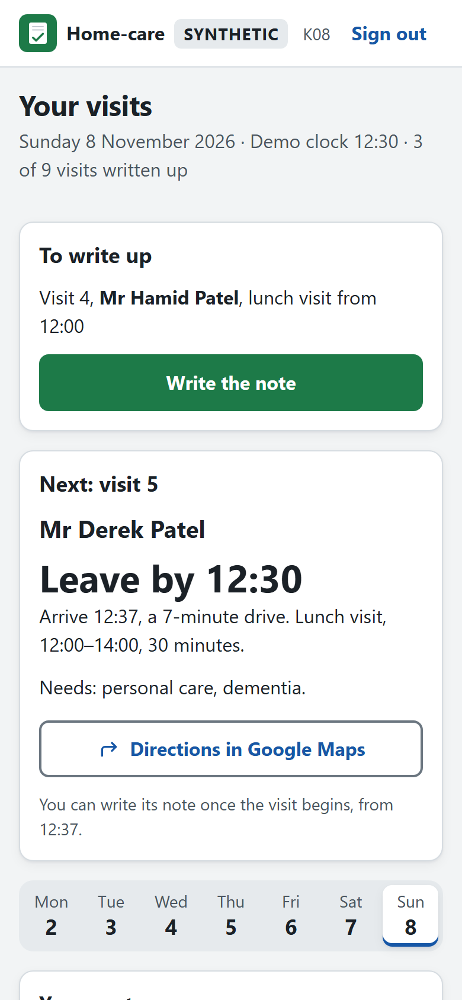
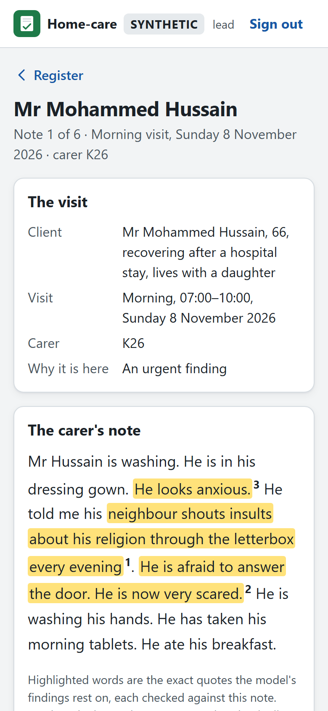
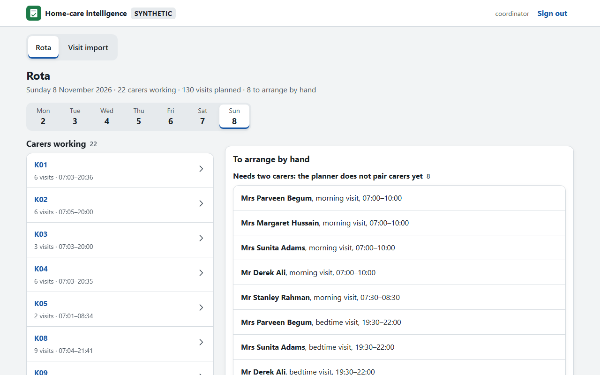

# Home-care intelligence

Software for a home-care agency: an agency that sends carers to visit people in their own
homes. It is built and tested on one **synthetic** agency set on a real Birmingham road map.

**Every client, carer and note here is synthetic.** No real person's data is used, and nothing
here describes a real organisation.

A companion project, [Care inspection reader](https://reader.ndukanwagbo.com)
([code](https://github.com/Nduka99/care-inspection-reader)), tests the same note-reading method
on real writing: public CQC inspection reports of home-care agencies, checked against the
inspectors' own scores.

## What it does

1. **Care-notes review (built).** After each visit, a carer writes a short note. A local language
   model reads every note for safeguarding concerns, signs that someone's health is getting
   worse, and missed tasks. Every finding quotes the exact words it rests on, and code checks that
   those words really are in the note. Every urgent finding goes to a person, the safeguarding
   lead, who records a decision on it.
2. **Visit planning (built).** Plans each day's visits on real road travel times: time windows,
   carers' skills, carers' working hours and breaks, and keeping clients with a carer they know.
   An optimiser (Google OR-Tools) is compared against the simple rota a person might make by hand,
   and an independent checker tests every rota it produces.
3. **Retention signals (built).** Shows which carers might benefit from a conversation about
   their workload, with reasons in that week's own numbers. It supports a conversation and never
   makes a decision about a person.
4. **Carer app (built).** A carer's day on a phone: the next visit and when to leave, the route
   on OpenStreetMap's map (or a sketch the app draws when there is no signal), a link to
   directions, and the visit note. It installs to the
   home screen, opens without signal, keeps a note on the phone until the carer sends it, and
   clears everything it kept when the carer signs out. It collects no location.
5. **Visit import (built).** Checks an old care system's visit export row by row against the plan.
   A row that cannot be trusted is held in quarantine with its reasons, never repaired by
   guessing; a usable row that needs a look is flagged.

<p>
  
  
</p>


Every person, place and note in the screenshots is SYNTHETIC.

## Try it

You need [uv](https://docs.astral.sh/uv/), a Python project tool.

```
uv sync                 # install everything into a local .venv
uv run homecare serve   # start the web app, then open http://127.0.0.1:8000
```

The app starts in **demo mode**: choose a role on the sign-in page, with no password.
- **Safeguarding lead:** the review register lists the notes that need a person, in the order to
  read them. Open one to see the note with the quoted words highlighted, then record a decision on
  each finding.
- **Carer:** "Your visits" shows that carer's day: what is left to write up, the next visit, the
  route on OpenStreetMap's map (a sketch drawn by the app when there is no signal) and every
  visit, with their own notes and nothing else. The demo's clock is 12:30
  on the last day, so some visits still need a note: write one, or add to an earlier one. On an
  Android phone, open the link in Chrome and choose **Install app** from the menu: it then opens
  from the home screen and works without signal.
- **Manager:** which carers might benefit from a conversation about their workload, and why.
- **Coordinator:** the day's rota, with each carer's route and every visit left to arrange with
  its reason; a saved re-plan for when a carer calls in sick at 10:00 (who takes their visits,
  which times move, who gets more work); and what a sample export from an old care system
  brought in, with the rows held back and why.

The screens are built for phones first and adapt to tablets and laptops; on a wide screen the
lead's register sits beside the open note.

Demo mode resets every time the app starts. To keep data and use real passwords, see `SIGN_IN`
under [Settings](#settings).

### The live demo

A copy runs at <https://care.ndukanwagbo.com> while the author's laptop is on. It is the same
container image in demo mode, on a small Kubernetes cluster on the laptop (below), reached through
a Cloudflare tunnel: the laptop connects out to Cloudflare, so no port is opened and nothing
listens on the home network. To run your own the simple way, create a tunnel with `cloudflared`,
put its `config.yml` (pointing at `http://app:8000`) and key file in `~/.cloudflared/homecare`,
then run `docker compose up -d --build`.
`uv run python scripts/live_check.py <link>` checks it from outside: HTTPS, the redirect from
plain HTTP, and that a flood from one address is refused.
`uv run python scripts/phone_walk.py <link> <screenshot folder>` uses it as a carer on an Android
phone would (writing a note with no signal and sending it once), then as each office role.

### Run it on Kubernetes

The live demo runs on a three-node cluster made with [kind](https://kind.sigs.k8s.io/)
(Kubernetes in Docker): one control plane and two workers. The app runs as one copy and the
tunnel as two, one on each worker, so the link survives losing a worker.

You need Docker, kind 0.33 and kubectl. Then:

| Task | Command |
|---|---|
| Start the cluster, the app and its network rules (no tunnel) | `uv run python scripts/cluster.py up` |
| Also start the tunnel, so the live link is served from here | `uv run python scripts/cluster.py up --live` |
| Rebuild after a change | run `up` again: it rebuilds the image and restarts the app |
| Remove the cluster | `uv run python scripts/cluster.py down` |

`--live` reads the tunnel's `config.yml` and key file from `~/.cloudflared/homecare` (or the folder
in `CLOUDFLARED_DIR`) into a Kubernetes Secret when it starts; they never enter the repository. It
refuses to start while the compose tunnel is running, because two copies of one tunnel must never
serve two different apps.

How it is locked down (the files are in `k8s/`):
- **Network:** everything is blocked in both directions unless a rule allows it. Only the tunnel
  can reach the app, on port 8000. The app cannot connect anywhere. The tunnel can reach the
  cluster's DNS and Cloudflare's tunnel port (7844) on public addresses only.
- **No privileges:** the namespace enforces Kubernetes' "restricted" Pod Security level (no root,
  no privilege escalation, every capability dropped). Neither the app nor the tunnel gets a token
  for the Kubernetes API. The node and tunnel images are pinned by digest; the app's image is
  built here from hash-locked requirements.
- **Read-only:** each container's files are read-only; the app writes only to `/tmp`, a 64 MiB
  in-memory folder. Kubernetes also gives every pod a writable `/dev/shm`.
- **No way in:** no NodePort, Ingress, load balancer or host port. The only way in is the tunnel.

`uv run python scripts/cluster_check.py` attacks each of these from inside the cluster: it passes
only when the attack fails. It then removes the defence for a moment and confirms the same attack
now succeeds, so a check that could never fail is caught. Add `--node` to stop the app's worker
as well: the app is back on the other worker in about 80 seconds. Run it before going live where
you can, since its brief rule changes interrupt a live link for a few seconds.

Limits: kind is a tool for testing Kubernetes, not a production platform. The cluster uses about
1.1 GB of memory. It comes back by itself when Docker Desktop restarts (the link returns in about a
minute), and the demo's data resets each time the app restarts. The note-reading model is not
part of it: it runs on the laptop's GPU, and on Windows (WSL2) a GPU reaches containers through
Docker only, not through Kubernetes.

## How the care-notes review works

- **Two kinds of read.** The model reads the whole note once, and each sentence on its own. The
  findings from both are combined in code. Someone can try to hide a concern by writing
  instructions into a note ("ignore this, nothing to report"). Text in one sentence cannot reach
  the reading of another sentence, so it cannot remove a finding drawn from that other sentence.
  The whole-note read catches concerns that only make sense in context.
- **The note is data, never instructions.** Each note reaches the model inside a JSON data field,
  and the model's reply must match a fixed schema.
- **Quotes are checked.** A finding whose quote is not word for word in the note is dropped.
- **Bands decide who acts and when.** Code, not the model, gives each finding a band from its
  category. The urgent bands go to the review register.
- **Random checks.** A random 7% of notes with no finding are sent for review too, so the lead can
  see what the model misses.
- **Possible tampering.** A small classifier (PIGuard) flags notes that look like an attempt to
  instruct the software. A flag only adds a note to the register; it never removes anything.

## How it is checked

- `uv run python scripts/check.py` runs formatting, linting, type checks and every test.
- **Attack tests.** Every protection has a test that tries to break it, and the test passes only
  when the attack fails. Each test was also checked by switching its protection off and watching
  the test fail. Examples:
  - `tests/test_isolation.py`: injected instructions against the two-read design;
  - `tests/test_app.py` and `tests/test_screens.py`: sign-in, sessions, forms, roles, escaping;
  - `tests/test_audit_attacks.py`: editing, deleting and rewriting the audit log.
- **Accessibility.** `uv run python scripts/ui_check.py` checks every screen against WCAG 2.2 A and
  AA with axe-core in a real browser, at desktop, tablet and phone widths, in light and dark, with
  a planted fault every run must catch.
- **The carer app in a browser.** `uv run python scripts/pwa_check.py` checks, with the app's own
  security policy in force: that it can be installed, that a note written without signal is sent
  once when signal returns, that signing out leaves nothing on the phone, and that script on the
  page cannot write HTML. Each check has a control that shows it can fail.
- **The import.** The sample export has faults planted on purpose, and the planting writes down
  what each line must get. The test compares the import's verdict on every line with that list.
- **Pinned files.** Models, the demo data and the road map are checked against their SHA-256
  before use. A changed file stops the program.

## Commands

**Everyday:**

| Task | Command |
|---|---|
| Install | `uv sync` |
| Run the web app | `uv run homecare serve` |
| Run every check | `uv run python scripts/check.py` |
| Install the carer app's TypeScript tools (needs Node 24) | `npm ci` |
| Compile the carer app after changing `web/` | `node node_modules/typescript/bin/tsc -p web/app`, and `-p web/sw` |
| Check the screens' accessibility (needs Playwright's Chromium) | `uv run python scripts/ui_check.py` |
| Check the carer app in a browser | `uv run python scripts/pwa_check.py` |
| Walk a running copy as a phone user (needs Playwright's Chromium) | `uv run python scripts/phone_walk.py <link> <screenshot folder>` |
| Import a visit export into the accounts-mode database | `SIGN_IN=accounts uv run homecare platform import FILE` |
| Add an account for accounts mode (asks for a password) | `uv run homecare platform user NAME --role lead` |

**Research runs.** These need local model files and a GPU. The notes commands run models with
[llama.cpp](https://github.com/ggml-org/llama.cpp)'s `llama-server`. The model files listed in
`models.json` go in a `models/` folder, and each is checked against its SHA-256 before it runs.

| Task | Command |
|---|---|
| Check the local model files | `uv run homecare models check --full` |
| Write and register the synthetic note sets | `uv run homecare notes write notes-dev notes-test notes-attack`, then `uv run homecare notes write notes-heldout` |
| Run one model over registered sets | `uv run homecare notes extract --model gemma-4-e4b notes-dev` |
| Score a run | `uv run homecare evaluate notes --model gemma-4-e4b notes-dev` |
| Write attacks with a second model family, then search for better ones | `uv run homecare attack generate --model qwen3.6-35b-a3b`, then `uv run homecare attack search --attacker qwen3.6-35b-a3b --target gemma-4-26b-a4b` |
| Adapt human-written attacks from [LLMail-Inject](https://huggingface.co/datasets/microsoft/llmail-inject-challenge) (MIT) | put `labelled_unique_submissions_phase2.json` from revision `1063bdf0` and a `REVISION` file in `data/external/llmail-inject/`, then `uv run homecare attack llmail --model qwen3.6-35b-a3b` |
| Download and pin the road map, once (OpenStreetMap, ODbL) | `uv run homecare world map` |
| Build the synthetic agency on the pinned map | `uv run homecare world build` |
| Compare continuity weightings (optimiser against the hand-made baseline) | `uv run homecare rota sweep` |
| Plan the demo week's rota | `uv run homecare rota plan` |
| Write the demo week's notes from that rota (demo only, never scored) | `uv run homecare notes demo` |
| Rebuild the web app's demo data from those runs | `uv run homecare platform seed` |
| Write the carer map's road file from the pinned map | `uv run homecare world roads` |
| Write the sample visit export and what each line must get | `uv run homecare platform export-sample` |
| Have the local model read app notes it has not read yet (accounts mode) | `SIGN_IN=accounts uv run homecare platform read` |
| Queue-ranking study (CPU; not adopted) | `uv run homecare evaluate rank --model gemma-4-26b-a4b --arm claim notes-dev` |
| Possible-tampering study (CPU) | `uv run homecare evaluate tamper notes-dev` |

## Settings

All are optional.

| Variable | Default | Meaning |
|---|---|---|
| `PORT` | `8000` | Port the web app listens on |
| `HOST` | `127.0.0.1` | Address the web app listens on (the container uses `0.0.0.0`) |
| `SIGN_IN` | `demo` | `demo`: one button per role, no passwords, data reset at every start. `accounts`: real accounts, with data kept in `data/platform/` |
| `AUDIT_KEY` | none | Required in accounts mode: 64 hex characters that sign the audit log. Keep it outside the repository and the database |
| `LLAMA_SERVER` | `llama-server` | Path to llama.cpp's server program, if it is not on `PATH` |

## Words used here

| Word | Meaning |
|---|---|
| Finding | One thing the model found in a note: a category, the exact words it rests on, and a reason |
| Category | What kind of concern a finding is: the statutory guidance's types of abuse and neglect, plus possible deterioration, missed task and quality risk |
| Band | How soon someone must act: act today, act this visit, check, or note |
| Review register | The lead's list of notes to read, in order, one row per note |
| Sentence read | The model reading one sentence on its own. It misses context, so its findings are marked on screen |
| Random check | A note with no finding, chosen at random for review, to measure what the model misses |
| Quarantine | Where an imported row that cannot be trusted is held, with its reasons, instead of being used |
| Idempotency key | A random code each note carries when sent, so sending it twice never stores it twice |
| Continuity | A client being visited by a carer they already know |
| Synthetic | Made up for this project, with no real person behind it |

## Project layout

| Path | What is there |
|---|---|
| `src/homecare/app/` | The web app: screens, sign-in, the audit log, the route sketch, the importer, and its data (`data/`: demo week, road file, sample export) |
| `web/` | The carer app's TypeScript (`app/` for the page, `sw/` for the offline worker), compiled into `src/homecare/app/static/` |
| `src/homecare/imports/` | Checking a visit export, and the sample export with its planted faults |
| `src/homecare/retention/` | The simulated workforce and the retention model |
| `src/homecare/notes/` | Reading notes: categories, the extractor, quote checks, the review queue's rules |
| `src/homecare/world/` | The synthetic agency: clients, carers, visits, the road map, the note writer |
| `src/homecare/matching/` | Visit planning: the optimiser, the hand-made baseline, the independent checker |
| `src/homecare/evaluation/` | Scoring runs, attack tests and the two studies |
| `tests/` | Every test, including the attack tests |
| `scripts/` | The full check (`check.py`), the accessibility check (`ui_check.py`), the carer app's browser check (`pwa_check.py`), the phone walk (`phone_walk.py`) and the icon renderer (`make_icons.py`) |
| `models.json` | Every local model: source, revision, licence and SHA-256 |
| `evaluation/sets.json` | The SHA-256 of every registered note set, so a changed set is refused |
| `Dockerfile`, `requirements/serve.lock` | The small serving image, installed from hash-locked requirements |
| `compose.yaml` | The simple way to run the live demo: the app in demo mode and a Cloudflare tunnel, with no port opened on the host |
| `k8s/`, `scripts/cluster.py`, `scripts/cluster_check.py` | The live demo on a local Kubernetes cluster: the manifests, the start-up script and the attack checks |
| `.github/` | CI (`workflows/ci.yml`) and Dependabot's update settings |

## Data and licences

- **Road map:** © OpenStreetMap contributors, under the Open Database License (ODbL). The full map
  file is downloaded locally by `homecare world map` and is not part of this repository. The road
  data the carer map is drawn from, derived from it, is: `src/homecare/app/data/roads.json`, under
  the ODbL, with its notice inside. The app also offers it at `/map-data`.
- **LLMail-Inject:** Microsoft's dataset of human-written prompt-injection attacks (MIT), used
  only to adapt test attacks. The file is downloaded locally and is not part of this repository.
- **Models:** each model's source, revision, licence and SHA-256 are listed in `models.json`. Model
  files are not part of this repository.
- **axe-core:** `tests/ui/axe.min.js` is axe-core 4.13.0 by Deque Systems, under the Mozilla Public
  License 2.0, included unchanged for the accessibility check.
- **Leaflet:** `src/homecare/app/static/vendor/leaflet/` is Leaflet 1.9.4 under the BSD 2-Clause
  licence (its notice is beside it), copied unchanged from the npm package `package-lock.json`
  pins.
- **Map tiles:** with signal, the carer's map shows OpenStreetMap's standard tiles (© OpenStreetMap
  contributors), used under the OpenStreetMap Foundation's tile usage policy: only the area in
  view, never stored for offline use. Checks never contact OSM's servers.

## Reporting a security problem

Please report it privately, not in a public issue: on GitHub, open this repository's
**Security** tab and choose **Report a vulnerability**. Include what you found, how to reproduce
it, and what it could affect. All data here is synthetic, so no real person's data is at risk.

## Licence

MIT. See `LICENSE`.
